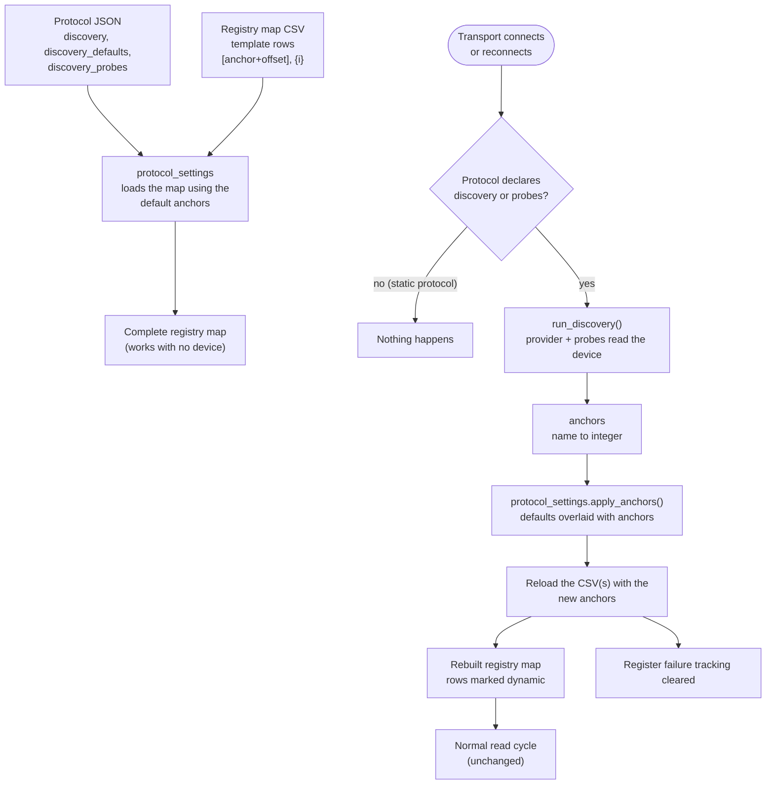

# Dynamic Register Discovery

Most protocol maps are **static**: every register sits at a fixed address and the CSV says where. Some specifications, SunSpec above all, let a device place its blocks wherever the attached equipment needs them. A SolarEdge inverter with two meters and no battery lays out its registers differently from the same inverter with a battery and one meter. A static CSV cannot describe that.

Dynamic register discovery lets a protocol describe its registers **relative to anchors** that the gateway reads from the device when it connects. Static protocols are not affected in any way and pay no cost.

## Table of Contents

- [How it fits together](#how-it-fits-together)
- [Turning it on for a protocol](#turning-it-on-for-a-protocol)
- [Template rows](#template-rows)
- [Anchors and defaults](#anchors-and-defaults)
- [Discovery probes](#discovery-probes)
- [The SunSpec provider](#the-sunspec-provider)
- [Repeating blocks](#repeating-blocks)
- [SunSpec maps in the library](#sunspec-maps-in-the-library)
- [What happens on connect and reconnect](#what-happens-on-connect-and-reconnect)
- [Naming of repeated equipment](#naming-of-repeated-equipment)
- [Runtime-only rows](#runtime-only-rows)
- [Writing a new provider](#writing-a-new-provider)
- [Limitations](#limitations)

---

## How it fits together



A **provider** answers "where did this device put its blocks?" and returns a dict of **anchors** (name to integer, usually a register address or an instance count). It never builds registry entries. The CSV describes each register as a **template row** relative to the anchors, and the same CSV loader that reads every other protocol turns the template rows into ordinary entries. Masks, screens, `_l`/`_h` merging, read ranges and the map size are therefore all computed by the existing code.

## Turning it on for a protocol

Add these keys to the protocol JSON. A protocol without `discovery` and `discovery_probes` is static and is never touched.

| Key | Description |
| --- | --- |
| `discovery` | Name of the provider to run on connect. Currently `sunspec`. |
| `discovery_defaults` | Object of anchor name to value. Template rows are resolved from these when the file is loaded, so the registry map is complete before any device has been read. |
| `discovery_probes` | Optional list of string probes that set anchors from a firmware or model string. See [Discovery probes](#discovery-probes). |
| `sunspec_base_address` | SunSpec provider only: wire address of the `SunS` marker. When absent, 40000, 0 and 50000 are tried in that order. |
| `sunspec_registry_type` | SunSpec provider only: `holding` (default) or `input`. |

## Template rows

A row is a template when its `register` cell contains a `[...]` expression, or when `{i}` appears in its register, `variable_name`, `documented_name`, `adjustments` or `note` cell.

| Syntax | Meaning |
| --- | --- |
| `[inverter_1_base+14]` | The value of anchor `inverter_1_base` plus 14. Arithmetic uses `+ - * / %` and parentheses. |
| `{i}` | The 1-based instance number. The row is repeated once per instance. |
| `[meter_{i}_base+18]` | Combine both: instance `i` of the meter block, offset 18. |

The number of instances comes from the anchor `<stem>_count`, where `<stem>` is the text in front of `_{i}_` in the register cell. For `[meter_{i}_base+18]` the stem is `meter`, so the count is the anchor `meter_count`. A count of zero, or a missing count, produces no rows: the equipment is not present.

If any anchor in a row's expression is unknown, the row is not an error. It is held back and no entry is created, the same as any other unresolved `[...]` row.

Example, from `solaredge_sunspec.holding_registry_map.csv` (offsets are measured from the model header, where the model ID register is offset 0, as in the SunSpec documents):

```csv
register,variable_name,documented_name,unit,data_type,...
[inverter_1_base+14],ac_power,AC Active Power,W,int16,...
[meter_{i}_base+18],meter_{i}_ac_power,Meter {i} AC Active Power,W,int16,...
```

With one inverter at 40069 and two meters found at 40181 and 40288, these become `ac_power` at 40083, `meter_1_ac_power` at 40199 and `meter_2_ac_power` at 40306.

## Anchors and defaults

The anchors a map is built from are always the JSON `discovery_defaults` overlaid with what discovery reported. They are never accumulated across reconnects, so equipment that has disappeared leaves the map.

Defaults that belong to the provider's namespace (for SunSpec: `model_*`, `inverter_*`, `meter_*` and friends) are discarded when the provider has read the device, so a block the device does not report is removed even though the defaults list it. Defaults outside that namespace, such as those set by probes, are only ever overridden.

The defaults for `solaredge_sunspec` reproduce the fixed layout the map used before it became a template, so nothing changes for a device that reports exactly that layout, and tools that read the map without a device (tests, the web UI, protocol analysis) still see every register.

## Discovery probes

Some manufacturers ship two register layouts under one protocol and the only difference is a firmware or model string. A probe reads such a string and sets an anchor:

```json
"discovery_probes": [
  {"anchor": "battery_legacy_count", "registry": "holding", "address": 40044, "count": 8,
   "prefix": "0003", "value": 3}
]
```

The probe reads `count` registers at `address`, decodes them as ASCII, and sets `anchor` to `value` if the text starts with `prefix`. A string that was read but does not match sets the anchor to `else_value` (default 0). A string that could not be read sets nothing, so the default applies. `address` is a wire (PDU) address, as in the CSV, and may be a number or a `0x` string.

## The SunSpec provider

A SunSpec device exposes a chain of models: the marker `SunS`, then a header (model ID, length) per model, ending with a header whose ID is `0xFFFF`. The provider walks the chain and reports:

| Anchor | Meaning |
| --- | --- |
| `sunspec_base` | Address of the `SunS` marker. |
| `model_<id>_<n>_base`, `model_<id>_<n>_length`, `model_<id>_count` | Header address and length of the n-th instance of model `<id>`, and the number of instances. |
| `<alias>_<n>_base`, `<alias>_<n>_length`, `<alias>_<n>_model`, `<alias>_count` | The same grouped by kind of equipment, so a map can ask for `inverter_1_base` without caring whether the device implements model 101, 102 or 103. |

Aliases: `inverter` (101, 102, 103), `inverter_float` (111, 112, 113), `meter` (201 to 204) and `meter_float` (211 to 214). The integer and float families have different register layouts, which is why they are separate aliases.

### Repeating blocks

Some models end in a run of identical sub-blocks. Model 160 (multiple MPPT) holds one 20-register block per MPPT input, after a 10-register header that includes the count `N` at offset 8. For these models the provider also reports where each sub-block starts, numbered across the whole chain:

| Anchor | Meaning |
| --- | --- |
| `mppt_<k>_base` | Address of the k-th MPPT module block (header address + 10 + 20 x (k - 1)). |
| `mppt_count` | Number of module blocks. |

The count is the model's own `N` register when it can be read, never larger than what the model's declared length can hold. If `N` cannot be read, the length decides. Rows then use the anchors like any other, for example `[mppt_1_base+9]` for the first module's DC current.

Other SunSpec-derived maps use the same pattern: put `"discovery": "sunspec"` and the default anchors in the JSON, and write the rows as offsets from the matching anchors. `solaredge_sunspec` is the worked example.

## SunSpec maps in the library

Every SunSpec protocol map below keeps its previous fixed layout as the `discovery_defaults`, so with no device (tests, the web UI, analysis) the map is exactly what it was. Only a device that reports something different changes it.

| Protocol | Marker address | Anchored on | Notes |
| --- | --- | --- | --- |
| `solaredge_sunspec` | 40000 | inverter (101-103), 120, 121, meters (201-204), early StorEdge battery block | Meter and battery rows exist only when found. The battery block is chosen by a firmware probe. |
| `fronius_sunspec` | 40000 | inverter float (111-113) **or** inverter integer (101-103), 120, 121 | Float and integer variants share variable names; whichever the inverter reports is used. The storage rows (40357+), Fronius-specific registers (211-216) and site totals (499-509) stay fixed. |
| `apsystems_ecu_sunspec` | 40000 | inverter float (111-113) | The common-model rows stay fixed. |
| `enphase_iq_gateway_sunspec` | 40000 | inverter (101-103), meter (201-204), DER model 704 | The meter follows the chain instead of being assumed to follow the inverter. The 704 rows disappear when the gateway has no model 704. Their offsets are still unverified. |
| `abb_fimer_vsn300_sunspec` | **0** | inverter (103), 160 and its MPPT modules, 120, 123 | Marker at address 0, set with `sunspec_base_address`. |
| `abb_fimer_react2_sunspec` | 40000 | inverter (101), 120, 121, 122, 123, 160 and its MPPT modules, vendor models 65230, 65233, 65234 | Models 126-145 that the map does not cover sit inside the model 123 gap. |
| `abb_fimer_sunspec` | 0 | not converted | The covered prefix (models 1, 103, 160 and vendor model 64061) is fixed by the vendor, so static rows are correct. Only the TRIO-only blocks after it (64062, 403, 64063) move, and the map does not cover them yet. |

The `abb_fimer_trio_*` maps are proprietary register maps rather than SunSpec and are unaffected.

## What happens on connect and reconnect

`modbus_base.init_after_connect()` calls `discover_register_structure()` before device identification, on the first connect and on every reconnect:

1. If the protocol is not dynamic, return immediately. No register is read.
2. Run the provider and probes (`run_discovery`).
3. Apply the anchors (`protocol_settings.apply_anchors`). If the resulting anchors equal those the map was already built with, nothing is rebuilt.
4. Otherwise reload the registry map(s) that contain template rows and **clear all register failure tracking**, because the trackers are keyed by address range and the ranges have just changed.

If the device does not answer, the layout already in place (the JSON defaults on first connect) is kept and a warning is logged. Discovery runs again on the next reconnect. A fault inside discovery is logged and never prevents the connection from coming up.

## Naming of repeated equipment

Equipment that repeats inside one device (meters, batteries, MPPT trackers) is named with an instance number inside the variable name, for example `meter_2_ac_power`. Device identity stays where it already is for every bridge: the transport's `device_identifier` (an MQTT topic segment, a Prometheus label, InfluxDB tags, a TimescaleDB device id). Separate physical devices on one bus are separate transports and are not prefixed.

Instance numbers follow the order the equipment appears in the device's chain. If equipment is added or removed in the middle of the chain, later instances renumber. For a time-series database that means `meter_1` can become a different physical meter after such a change.

## Runtime-only rows

Entries created from a template row carry `registry_map_entry.dynamic = True`. The flag exists only in memory. It is never read from or written to a CSV, so discovered rows cannot be committed back to a protocol file, and code that reads the live map (the web UI, analysis) can tell them apart from literal rows. Static protocols never set it.

## Writing a new provider

1. Subclass `classes.discovery.base.DiscoveryProvider` in a new module, set `name`, and implement `discover(reader, protocol)`. Use `reader.read_discovery_registers(start, count, registry_type)`, which makes a single attempt and returns the words or `None`.
2. Return a `DiscoveryResult` with the anchors, and with `owned_patterns` matching every anchor name the provider can emit.
3. Register the class in `_PROVIDERS` in `classes/discovery/__init__.py`.
4. In the protocol JSON set `"discovery": "<name>"` and `discovery_defaults`, and write the CSV rows as templates.

## Limitations

- Discovery reads the device once per connect. A device whose structure changes while it stays connected is picked up at the next reconnect.
- If discovery cannot read the device on connect, the defaults stay in force until the next reconnect.
- Startup order is: every transport connects (and discovers), then the bridges are initialized. The first discovery therefore always runs before a bridge such as TimescaleDB creates its columns from the register names. Equipment that first appears at a *later* reconnect changes the map after the bridges were initialized; restart the gateway so the bridges register the new variable names. (Whether a bridge picks up new names without a restart was not checked.)
- Template rows that use `{i}` need a `<stem>_count` anchor. A row with `{i}` and no `_{i}_` anchor in its register cell is skipped with a warning.
