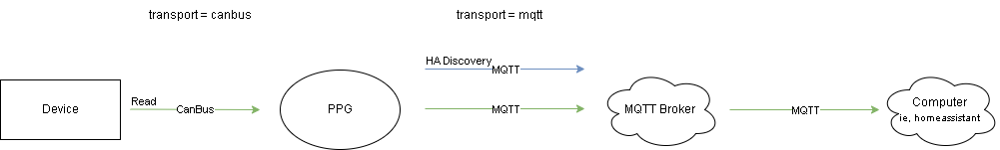

#



## CanBus to MQTT

``` ini
[general]
log_level = DEBUG

[transport.0] #name must be unique, ie: transport.canbus
#canbus device
#protocol config files are located in protocols/
protocol_version = victron_gx_generic_canbus

#canbus port or interface; varies based on usb adapter
port = can0
bustype = socketcan
baudrate = 500000

#the 'transport' that we want to share this with
bridge = transport.1

manufacturer = {{Your device's manufacturer here}}
model = {{Your device's model number here}}
#optional; leave blank (or omit) to autodetect the serial number from the frames the device broadcasts.
#MPG listens briefly, picks the frame that looks most like a serial number and logs its CAN ID.
serial_number = {{random numbers here}}

#optional; once the log shows which CAN ID carried the serial number, pin it here so startup
#skips the guesswork (accepts decimal or hex, ie: 0x35E)
#serial_number_can_id = {{CAN ID}}

# canbus is a passive protocol, this is how often information is sent to mqtt. actual data interval is dependant on device
read_interval = 10 


[transport.1]
#connect mqtt
transport=mqtt
host = {{mqtt ip / host}}
port = 1883
user = {{mqtt username here}}
pass = {{mqtt password}}
base_topic = home/inverter/
error_topic = /error
json = false
discovery_enabled = true
discovery_topic = homeassistant
```
